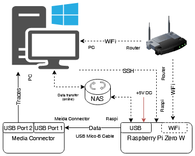
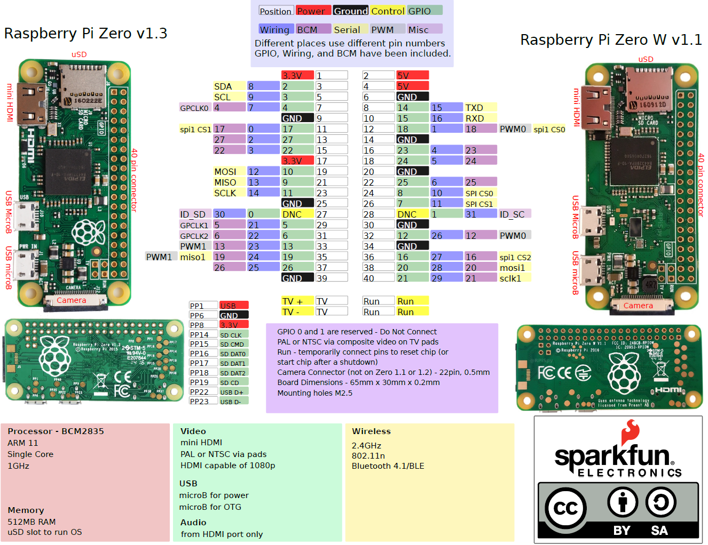
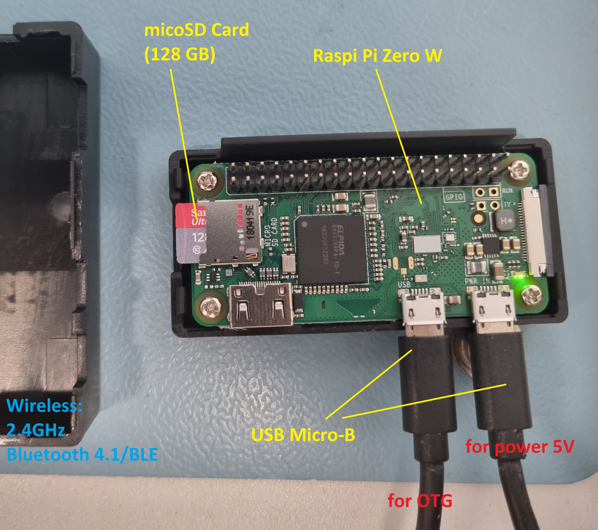
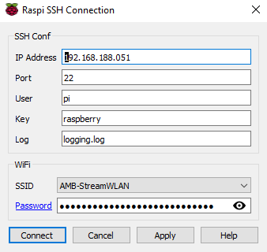
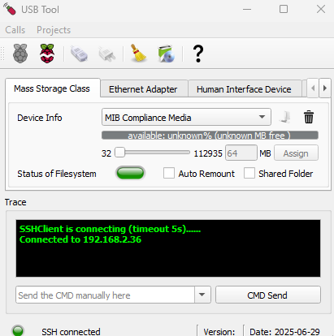
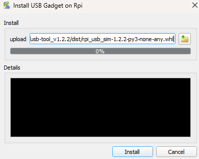
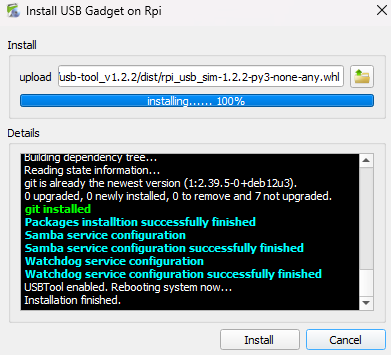
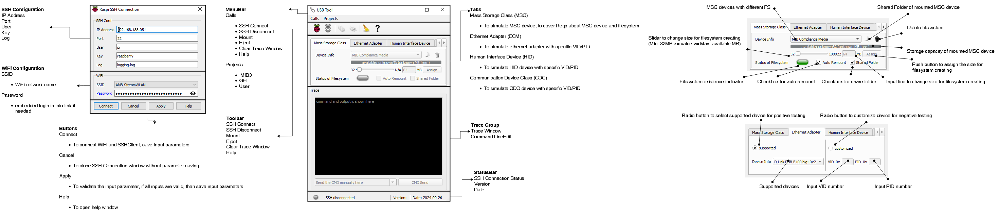
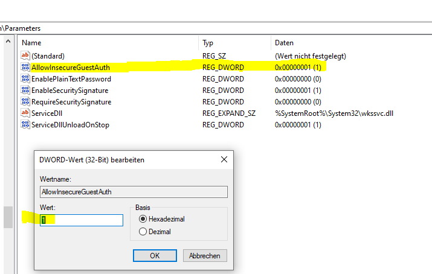

# Raspberry Pi USB Simulator

<p align="center">
  
</p>

Raspberry Pi USB Simulator turns a Raspberry Pi Zero W into a USB device for testing host PCs and embedded devices. It provides a Windows GUI, SSH-based device control, and Robot Framework support for automated testing.

Supported USB device types:

- MSC - Mass Storage
- HID - Human Interface Device
- ECM - Ethernet Control Model
- CDC - Communications Device Class
- NCM - Network Control Model
- MTP - Media Transfer Protocol
- UAC - USB Audio Class
- MULTI - Multiple interfaces

## Requirements

### Hardware

- Raspberry Pi Zero or Raspberry Pi Zero W
- One microSD card and card reader
- Two micro USB cables:
  - one OTG cable for the data connection
  - one for power
- A 2.4 GHz Wi-Fi network
- A USB Wi-Fi adapter for the test PC if it has no usable Wi-Fi

### Software

- Windows test PC
- [Raspberry Pi Imager](https://www.raspberrypi.com/software/)
- [USB Simulator release package](https://github.com/luxc1101/raspi-usb-sim/releases)

> The Raspberry Pi and test PC must be able to reach each other over the same Wi-Fi network.

## Quick start

### 1. Prepare the Raspberry Pi

1. Open Raspberry Pi Imager.
2. Select **Raspberry Pi Zero**.
3. Select **Raspberry Pi OS (Legacy, 32-bit) Lite** (Bullseye or Bookworm is recommended).
4. Select the microSD card.
5. Configure the OS:
   - Hostname, for example `rpi0`
   - Username and password
   - 2.4 GHz Wi-Fi SSID and password
   - Country
   - Timezone
   - Keyboard layout
   - Enable SSH
6. Write the OS image and insert the microSD card into the Raspberry Pi.

To configure the Raspberry Pi's Wi-Fi from the SD card, see [Wi-Fi configuration](#wi-fi-configuration).

### 2. Connect the hardware

1. Connect the USB OTG/data cable to the Pi Zero OTG port and to the DUT or test PC.
2. Connect the power cable.
3. Wait for the Raspberry Pi to join the configured Wi-Fi network.
4. Find the Raspberry Pi IP address through your router, mobile hotspot, or this command:

   ```bash
   ping rpi0.local
   ```

   If the hostname does not resolve, use the router or hotspot client list to find the Pi's IP address.

<p>
  
  
</p>

### 3. Install USB Simulator on Windows

1. Download the latest `usb-tool_<tag>.zip` package from [GitHub Releases](https://github.com/luxc1101/raspi-usb-sim/releases).
2. Extract the ZIP file.
3. Keep `USBSimulator.exe` and the `config` folder at the same directory level.
4. Start `USBSimulator.exe`.

The package layout is:

```text
usb-tool-vX.X.X/
├── USBSimulator.exe
├── config/
│   ├── Config.json
│   └── device_proj.json
├── wificonfig/
│   ├── ssh
│   └── wpa_supplicant.conf
├── rpi_usb_sim-*.whl
└── rpi_usb_sim-*.tar.gz
```

### 4. Connect to the Raspberry Pi

1. In the USB Simulator GUI, select **SSH Connect**.
2. Enter:
   - Hostname or IP address
   - Port, usually `22`
   - Username
   - Password
3. Select **Connect**.





A green status indicator means the SSH connection is active.

### 5. Install the Raspberry Pi runtime

1. Select **Install USB Gadget**.
2. Choose the `rpi_usb_sim-*.whl` file from the release package.
3. Start the installation and wait for it to finish.
4. The Raspberry Pi will reboot after a successful installation.







After the reboot, reconnect over SSH.

## Using the GUI

The interface contains an SSH menu, device tabs, a command trace window, and a connection status indicator.





### Actions

| Action | Purpose |
| --- | --- |
| SSH Connect / Disconnect | Open or close the Raspberry Pi SSH session |
| Mount | Activate the selected USB gadget |
| Eject | Disable the active USB gadget |
| Install USB Gadget | Transfer and install the runtime wheel |
| Clear | Clear the trace and command output |
| MSC | Create or mount a mass-storage filesystem |
| ECM / CDC / NCM | Configure network or communication devices |
| HID | Configure keyboard or HID input |
| MTP | Configure a Media Transfer Protocol device |
| UAC | Configure a USB audio device |

The trace window shows SSH commands and their output. The command line editor can send commands directly to the Raspberry Pi.

### Mount a device

1. Connect to the Raspberry Pi.
2. Open the tab for the required USB device class.
3. Set its VID and PID, or use the default device configuration.
4. Configure any device-specific options, such as a filesystem for MSC.
5. Select **Mount**.

Use **Eject** before changing the active device type.

## Command-line runtime

The runtime package installs three console commands:

| Command | Purpose |
| --- | --- |
| `usbsim-gui` | Start the runtime GUI |
| `usbsim-robot` | Run a USB gadget for Robot Framework or automation |
| `usbsim-setup` | Install the Raspberry Pi system configuration |

Run `usbsim-setup` on the Raspberry Pi after installing the wheel. It installs system packages, enables the USB gadget modules, configures Samba and the filesystem watchdog, and reboots the Pi.

For automation help:

```bash
usbsim-robot --help
```

Example:

```bash
usbsim-robot --type HID --vid 0x1234 --pid 0x5678 --enable_input 1 --input "hello world"
usbsim-robot --type MSC --fs FAT32
usbsim-robot --type EJECT
```

Supported `--type` values are `MSC`, `HID`, `ECM`, `CDC`, `NCM`, `MTP`, `UAC`, `MULTI`, `EJECT`, and `DELETE`.

## Wi-Fi configuration

Skip this section when Wi-Fi was configured correctly in Raspberry Pi Imager and has not changed.

### Bullseye and older OS images

Place `ssh` and `wpa_supplicant.conf` in the SD card boot partition.

```ini
country=DE
update_config=1
ctrl_interface=DIR=/var/run/wpa_supplicant GROUP=netdev

network={
    key_mgmt=WPA-PSK
    ssid="YOUR_WIFI_SSID"
    psk="YOUR_WIFI_PASSWORD"
}
```

### Bookworm and newer OS images

Connect to the Raspberry Pi over SSH, or use a temporary network connection, then run:

```bash
nmcli dev wifi list
sudo nmcli dev wifi connect "YOUR_WIFI_SSID" password "YOUR_WIFI_PASSWORD"
```

For a mobile hotspot, ensure that the test PC and Raspberry Pi use the same 2.4 GHz hotspot and that hotspot access is allowed.

## Troubleshooting

### `rpi[x].local` does not resolve

Use the router or hotspot client list to find the Pi's IP address, then connect to that address instead of the hostname.

### USB gadget is not detected

- Confirm the Raspberry Pi Zero OTG port is connected.
- Run the runtime installation and allow the required reboot.
- Verify `dtoverlay=dwc2` and `modules-load=dwc2` are present after installation.
- Reconnect the OTG cable after the reboot.

### The NTFS filesystem is reported as unclean

This warning is normally shown when the filesystem was removed without safely ejecting it from Windows:

```text
WARN: The disk contains an unclean file system (0, 0).
WARN: The file system wasn't safely closed on Windows. Fixing.
```

Safely eject the shared drive from Windows before disconnecting or ejecting it.

### Windows cannot open the shared folder

If Windows rejects an SMB guest logon, enable insecure guest authentication:

1. Open **Registry Editor**.
2. Go to `HKEY_LOCAL_MACHINE\SYSTEM\CurrentControlSet\Services\LanmanWorkstation\Parameters`.
3. Create or edit `AllowInsecureGuestAuth` as a `DWORD`.
4. Set its value to `1`.





## Development

### Requirements

- Python 3.10 through 3.12
- Poetry

Install dependencies and run the Windows GUI:

```powershell
poetry install
poetry run python app/Main.py
```

Build the runtime package:

```powershell
cd app
poetry build
```

Run Robot Framework test cases:

```powershell
cd testcases
poetry install
poetry run robot test_keywords.robot
```

## Project structure

```text
app/
├── Main.py                  # Windows GUI entry point
├── src/                     # USB gadget implementations
├── scripts/                 # Raspberry Pi runtime and installer
└── config/                  # GUI configuration
testcases/
├── test_keywords.robot      # Robot Framework keywords
└── resource/                # Robot Framework resources
image/                       # README screenshots
```
